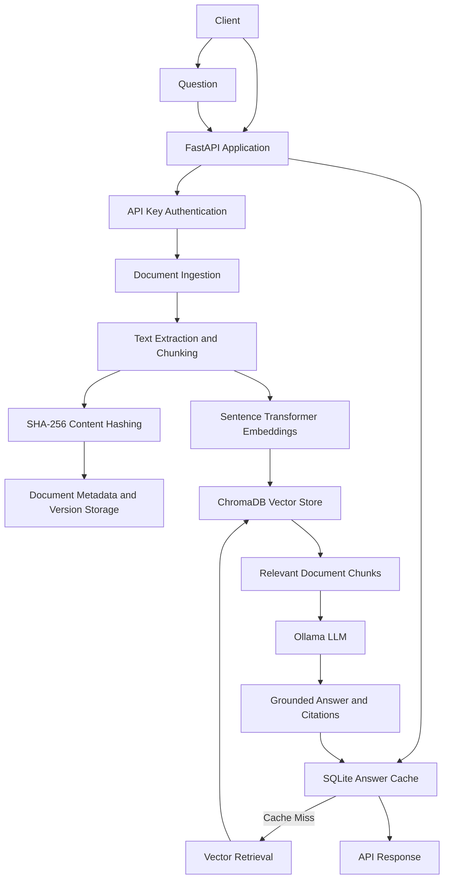

# VersionAware RAG Assistant

[](https://github.com/YOUR_GITHUB_USERNAME/version-aware-rag-assistant/actions/workflows/ci.yml)

A local-first, version-aware Retrieval-Augmented Generation (RAG) application built with Python, FastAPI, ChromaDB, Sentence Transformers, and Ollama.

The application allows users to upload documents, retrieve relevant information, and generate answers grounded in document content. It also implements document version tracking and cache invalidation to prevent outdated answers from being reused after documents change.

## Key Features

- **Document ingestion:** Upload PDF and TXT documents.
- **Text processing:** Extract, normalize, and split documents into overlapping chunks.
- **Content hashing:** Use SHA-256 hashes to detect document changes.
- **Version tracking:** Maintain document versions when content changes.
- **Vector search:** Generate embeddings and retrieve relevant chunks using ChromaDB.
- **Local LLM integration:** Generate grounded answers using Ollama.
- **Source citations:** Associate generated answers with supporting document sources.
- **Version-aware caching:** Cache answers and invalidate stale entries when source documents change.
- **API authentication:** Protect application endpoints using API key authentication.
- **Structured logging:** Record request information, errors, and application activity.
- **Centralized error handling:** Return consistent structured API errors.
- **Docker support:** Run the application and Ollama using Docker Compose.
- **CI/CD:** Automatically execute tests through GitHub Actions.

## Technology Stack

| Component | Technology |
|---|---|
| Language | Python 3.12 |
| API framework | FastAPI |
| API server | Uvicorn |
| Document processing | pypdf |
| Embeddings | Sentence Transformers |
| Embedding model | all-MiniLM-L6-v2 |
| Vector database | ChromaDB |
| LLM runtime | Ollama |
| Default example LLM | llama3.1:8b |
| Metadata storage | JSON |
| Answer cache | SQLite |
| Testing | Pytest |
| Containerization | Docker and Docker Compose |
| CI/CD | GitHub Actions |

## Architecture



## Project Structure

```text
version-aware-rag-assistant/
│
├── .github/
│   └── workflows/
│       └── ci.yml
│
├── app/
│   ├── __init__.py
│   ├── answer.py
│   ├── answer_cache.py
│   ├── ingestion.py
│   ├── logging_config.py
│   ├── main.py
│   ├── security.py
│   ├── storage.py
│   └── vector_store.py
│
├── data/
│   └── .gitkeep
│
├── tests/
│   ├── conftest.py
│   ├── test_answer.py
│   ├── test_answer_cache.py
│   ├── test_error_handlers.py
│   ├── test_health.py
│   ├── test_ingestion.py
│   ├── test_security.py
│   └── test_vector_store.py
│
├── .dockerignore
├── .env.example
├── .gitignore
├── Dockerfile
├── compose.yaml
├── requirements.txt
└── README.md
```

## How Version Awareness Works

The application tracks document changes using content hashes and version numbers.

1. A user uploads a document.
2. The application extracts and normalizes its text.
3. A SHA-256 hash is calculated from the document content.
4. The document is split into overlapping chunks.
5. Document metadata and version information are stored.
6. Chunks are indexed in ChromaDB with document ID and version metadata.
7. When a document is uploaded again:
    - Unchanged content is recognized using its hash.
    - Changed content increments the document version.
8. Cached answers retain references to their source document versions.
9. When a source document changes, cached answers depending on the previous version are invalidated.

This helps prevent the application from returning answers based on outdated document content.

## Getting Started – Local Setup

### Prerequisites

- Python 3.12
- Git
- Ollama
- Sufficient memory and disk space for the embedding model and selected LLM

### 1. Clone the repository

```bash
git clone https://github.com/YOUR_GITHUB_USERNAME/version-aware-rag-assistant.git

cd version-aware-rag-assistant
```

### 2. Create a virtual environment

```bash
python3.12 -m venv .venv

source .venv/bin/activate
```

### 3. Install dependencies

```bash
python -m pip install --upgrade pip

pip install -r requirements.txt
```

### 4. Configure environment variables

Create your local environment file:

```bash
cp .env.example .env
```

Example configuration:

```env
RAG_API_KEY=replace-with-a-secure-random-key
OLLAMA_MODEL=llama3.1:8b
RAG_MAX_COSINE_DISTANCE=0.65
```

Generate a secure API key and replace the placeholder. Never commit `.env` to Git.

Load the variables into your shell:

```bash
set -a
source .env
set +a
```

### 5. Start Ollama

Install and start Ollama using its official installation instructions.

Download the configured model:

```bash
ollama pull llama3.1:8b
```

Make sure Ollama is running and accessible to the application.

### 6. Start the FastAPI application

```bash
uvicorn app.main:app --reload
```

Application URL:

```text
http://localhost:8000
```

Interactive API documentation:

```text
http://localhost:8000/docs
```

Health endpoint:

```text
http://localhost:8000/api/health
```

## Running with Docker

Docker Compose starts the FastAPI application and Ollama services.

### 1. Configure environment variables

```bash
cp .env.example .env
```

Set a secure `RAG_API_KEY` in `.env`.

### 2. Build and start services

```bash
docker compose up --build -d
```

### 3. Download the Ollama model

```bash
docker compose exec ollama ollama pull llama3.1:8b
```

Use the model configured in your `.env` file if you choose a different model.

### 4. Check running containers

```bash
docker compose ps
```

### 5. View application logs

```bash
docker compose logs -f app
```

### 6. Stop services

```bash
docker compose down
```

Document data and model data are persisted using Docker volumes and the configured host data directory.

## API Documentation

Base URL:

```text
http://localhost:8000
```

Protected endpoints require this HTTP header:

```text
X-API-Key: YOUR_API_KEY
```

### 1. Health Check

**GET** `/api/health`

Authentication: Not required.

```bash
curl http://localhost:8000/api/health
```

### 2. Upload Document

**POST** `/api/documents/upload`

Authentication: Required.

Supported formats: PDF and TXT.

Maximum upload size: 5 MB.

```bash
curl -X POST \
  http://localhost:8000/api/documents/upload \
  -H "X-API-Key: YOUR_API_KEY" \
  -F "file=@sample.txt"
```

### 3. List Documents

**GET** `/api/documents`

Authentication: Required.

```bash
curl http://localhost:8000/api/documents \
  -H "X-API-Key: YOUR_API_KEY"
```

### 4. Get Document Details

**GET** `/api/documents/{document_id}`

Authentication: Required.

```bash
curl http://localhost:8000/api/documents/YOUR_DOCUMENT_ID \
  -H "X-API-Key: YOUR_API_KEY"
```

### 5. Retrieve Relevant Chunks

**POST** `/api/retrieve`

Authentication: Required.

Request:

```json
{
  "question": "What is the document retention policy?",
  "top_k": 3
}
```

Example:

```bash
curl -X POST \
  http://localhost:8000/api/retrieve \
  -H "Content-Type: application/json" \
  -H "X-API-Key: YOUR_API_KEY" \
  -d '{
    "question": "What is the document retention policy?",
    "top_k": 3
  }'
```

### 6. Generate an Answer

**POST** `/api/answer`

Authentication: Required.

Request:

```json
{
  "question": "What is the document retention policy?",
  "top_k": 3
}
```

Example:

```bash
curl -X POST \
  http://localhost:8000/api/answer \
  -H "Content-Type: application/json" \
  -H "X-API-Key: YOUR_API_KEY" \
  -d '{
    "question": "What is the document retention policy?",
    "top_k": 3
  }'
```

The answer endpoint retrieves relevant chunks, generates an answer using the configured LLM, validates citations, and uses the SQLite cache when a valid cached answer exists.

## Error Handling and Security

Protected endpoints require API key authentication through `X-API-Key`.

The application includes:

- API key validation using constant-time comparison.
- Upload extension and file-size validation.
- Empty-file validation.
- Structured error responses.
- Request IDs for request tracking.
- Generic error messages for unexpected server failures.

The health endpoint remains publicly accessible.

## Running Tests

Activate the virtual environment:

```bash
source .venv/bin/activate
```

Run the complete test suite:

```bash
pytest -v
```

Run an individual test module:

```bash
pytest tests/test_answer.py -v
```

Run tests with a concise summary:

```bash
pytest -q
```

The test configuration supplies a test-only API key. Answer-generation tests mock Ollama calls rather than requiring a live LLM server.

The vector-store tests may still require the embedding model to be available locally or downloaded.

## Continuous Integration

GitHub Actions runs the test suite automatically when code is pushed to the configured branches or a pull request is opened.

Workflow location:

```text
.github/workflows/ci.yml
```

The pipeline:

1. Checks out the repository.
2. Sets up Python 3.12.
3. Installs project dependencies.
4. Configures test environment variables.
5. Executes the Pytest suite.

Check the **Actions** tab in GitHub to view workflow results.

## Configuration Reference

| Variable | Purpose | Example |
|---|---|---|
| `RAG_API_KEY` | API authentication secret | Secure random key |
| `OLLAMA_MODEL` | Ollama model name | `llama3.1:8b` |
| `RAG_MAX_COSINE_DISTANCE` | Retrieval relevance threshold | `0.65` |
| `OLLAMA_HOST` | Ollama service address | `http://localhost:11434` |

## Current Limitations

- The application uses local storage and a local vector database.
- Document storage synchronization uses process-local locking; multi-worker concurrency safety has not been implemented.
- LLM answer quality depends on the selected Ollama model and retrieved evidence.
- Large embedding and LLM models require additional memory and disk space.
- Integration testing of the complete Docker workflow is not yet included in the test suite.

## Future Enhancements

- Improve multi-worker concurrency safety.
- Add document deletion and reindexing APIs.
- Support additional document formats.
- Add user-level authorization and access control.
- Improve retrieval quality through reranking.

